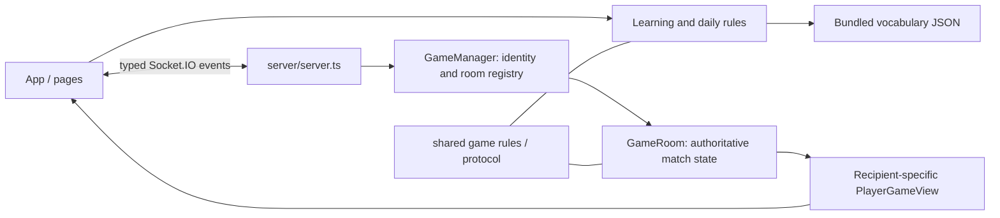

# Architecture

## Runtime and entry points

Penjat is a React 19/Vite 8 TypeScript SPA and a Node HTTP service with Socket.IO 4. There is no Express, router library, database, global state library or runtime vocabulary API. `src/main.tsx` mounts `App` in StrictMode. `src/routing.ts` normalizes paths; `App.tsx` manages browser history, modes, interface/game language, room snapshots, chat, the site header/footer and guarded exits. Routes: `/`, `/multijugador/`, `/aprendre/`, `/paraula-del-dia/`, `/com-es-juga/`.

`server/server.ts` serves `dist/`, route-specific SEO metadata, legacy Spanish redirects, `/health`, room previews at `/api/rooms/:code/preview`, and Socket.IO. Development uses Vite plus the separate server; production serves both on one origin. There is no service worker or backend persistence. `render.yaml`, README and package scripts describe single-process hosting; deployment is outside routine verification.

## Ownership and boundaries

| State | Owner | Lifetime |
| --- | --- | --- |
| Learning round, attempt history, summary | `LearningPage`, pure `learning/game.ts` rules | Mounted page only |
| Daily round | `DailyChallengePage`, `daily/game.ts` | Replayed from local storage for current Madrid date |
| Homepage daily summary (number, won/lost, mistakes) | `HomePage`, pure `daily/homeSummary.ts` | Re-read on mount, focus, storage events and each minute; never shows the word |
| Match, score, turn roster, forgiveness, secret word | `GameRoom` | Server process / room |
| Identity → room/socket mappings | `GameManager` | Server process |
| Disconnect timers | `server.ts` | 25 seconds after socket loss |
| Room view, chat display, typing display | `App` | Current client |
| Name, languages, selected learning level | `localStorage` | Browser origin |
| Room code/player ID/reconnect token | `sessionStorage` | Tab session (can be copied by browser tab duplication/opener) |

Clients send intent (`game:guess`, `round:set-word`, etc.). Server resolves socket identity, validates, mutates `GameRoom`, acknowledges and broadcasts individually serialized `viewFor(playerId)` snapshots. Guessers never receive the active secret word or other players' private progress; setter observation receives a selected board and setter-only forgiveness requests. Chat uses separate events and a bounded in-memory history of 50 messages. Completion retains the room for rematches; explicit departure or expired reconnect grace removes membership, deleting the room when no active members remain.

## Vocabulary and local game logic

`learning/vocabulary.ts` validates the bundled 544-entry `data/vocabulary.json`. `learning/game.ts` filters CEFR metadata: basic=A1/A2, intermediate=B1/B2, advanced=C1/C2, all=classified entries. The legacy `difficulty` field is distinct. Selection favors unseen words, permits failed-word review after a cooldown and falls back within the selected pool. Daily mode resolves a fixed 32-ID ordered pool against the same dataset; day index from the Madrid date and fixed epoch selects the word.

The offline Python pipeline is in `scripts/vocab_pipeline.py`, with small command wrappers. Source/license and review provenance live in `data/README.md`; approved baseline is `docs/vocabulary-v1.md`. Experiments under `data/experiments/` are ignored and must not become runtime dependencies. Reviewed metadata is merged by stable ID using `data/review/linguistic-metadata.json`. Ordinary builds never call external APIs.

`shared/game.ts` is the active shared normalization/matching implementation. Older `src/game/game.ts` and word lists remain; inspect callers before reusing them. Learning and daily rules are similar but have different session/persistence lifecycles.

## Styling and typography

Plain CSS: `src/index.css` holds the font faces and shared tokens, and `src/App.css` holds component rules. There is no CSS framework.

- **Fonts.** `--font-display` (self-hosted Fraunces, with Georgia/serif fallbacks) is for the brand, expressive headings, game words and outcomes. `--font-ui` is for body text, controls, names, chat, scores and functional panel titles. It is *Penjat UI*, a self-hosted 30.6 kB WOFF2 subset of Source Sans 3 (OFL, renamed because of the Reserved Font Name; see `src/assets/fonts/README.md`), with metric-matched Arial/Helvetica fallback faces in regular and bold (with `font-synthesis: none`, a regular-only fallback would flatten all semibold/bold text if the web font fails). The build preloads the hashed font (`vite.config.ts`).
- **Identity.** The exact Lovable OKLCH paper/ink/magrana/saffron/teal/olive palette and contrast-tested semantic roles (including `--mar-surface`/`--oliva-surface` tints) live in `index.css`. Buttons and major cards use Lovable's printed treatment: 2px ink outlines and 3px (phones) / 4px offset shadows that lift on hover and press in on click (no movement with reduced motion). Segmented choices and the selected option are inked; supporting panels (help sections, history rows) keep outlines without shadows. Display headings use `--text-hero`/`--text-display`/`--text-section`/`--text-card-title` and an italic accent word (`<em>`, slant synthesised only there because Fraunces ships one upright face). Labels are sentence case, not small uppercase. The shared `HangmanDrawing` has explicit six-error body parts, hat/head and scarf/torso pairs, a rescued victory pose and a quiet defeat expression. Adjacent translated counts/outcomes make game/result drawings decorative. Only newly revealed parts animate, with reduced-motion support.
- **Site shell.** `SiteHeader` replaces the old floating back button and language toggle: wordmark link, the four routed sections (`navigation/links.ts`, `aria-current` on the current one, which alone gets a compact ink pill like the selected CA/ES code; the header is a compact 56px bar on a hairline: 14px links in 32px pills, a 28px badge, an 82×34 CA/ES pill and 36px round controls, each keeping a 44px hit area), a contextual exit (`.global-back-button`: leave the room/match, end the learning session) and the CA/ES pill. From 1000px the sections are inline; below, a disclosure button opens an overlay menu (no layout shift) with Inici and the sections; it offers the interface language only where the header hides its CA/ES pill (below 384px beside a contextual exit, and below 320 CSS px), so the language appears once. It closes on Escape (focus returns to the button), an outside pointer press, focus leaving the header, navigation, and growing past 1000px. Below 384px a contextual exit replaces the header language pill (still in the menu). The header scrolls with the page; it is sticky only on large content pages (home, help, multiplayer setup ≥1000×600). `App.navigate` guards header links: leaving a waiting room or an active match, or an unfinished learning/daily game, asks first (`ExitConfirmationDialog` has `game` and `room` copy). Browser Back/Forward use the same guard (`navigation/history.ts`): every entry the app writes stores `penjatIndex`, so a guarded popstate is undone with `history.go(-delta)` and the dialog opens on the page it protects; Cancel keeps the game, Confirm replays the move. Any applied history move closes a pending dialog and leaves a room (as header links do). A skip link focuses `<main>`. `SiteFooter` (a light strip under a hairline: wordmark, tagline and the section links) closes the home, help and setup pages. On the homepage a static, decorative (`aria-hidden`) full-bleed ink band of Catalan words with saffron ✦ separators divides the hero from the mode cards; the words drift left at an ambient 6 CSS px/s (`BAND_SPEED` in `HomePage`): `WordBand` renders identical copies, each a whole number of pixels wide, and shifts by exactly one copy per linear cycle, so the loop is seamless; it measures the band and renders `ceil(bandWidth / copyWidth) + 1` copies so the moving track covers any viewport or zoom. The band itself is the pause control (a native button with a CA/ES pause/resume label and tooltip; click, tap, Enter or Space; inset saffron focus ring) while its words stay hidden from assistive technology; with reduced motion it renders as a static, non-interactive band. The band has more room above than below, and extra space before the mode section. From 600px the hero's daily entry is a tertiary one-line hairline pill (no fill or shadow) under the two actions. The mode cards lead with their title (no icon badge), and the main hero action carries a CSS-drawn arrow so its accessible name is unchanged. Page heads (`.page-head`: colour eyebrow, Fraunces heading, lede) replace the per-page brand marks.
- **Phone homepage hero.** At ≤599px (37.4375em, so enlarged text also gets it) the hero is a single column: eyebrow, `<h1>` and lede, then the character drawing and letter slots without the preview card frame, then `.home-quick`. That nav repeats the `.home-modes` destinations in a new order: a full-width ~104px magrana **Jugar** link (`/multijugador`, the existing main action; there is no separate solo mode) and two equal 68px cards, *Aprèn català* and *Paraula del dia*, with the challenge number and a ✓ once played. Phones hide `.home-modes`, and wider screens hide `.home-quick`, so only one of the two is ever rendered or focusable. The tablet and desktop hero are unchanged. Below 375px the card icons lose their circles. Below 360px the drawing shrinks and the Jugar arrow is hidden. Below 320 CSS px the cards stack and Jugar centres its content.
- **Multiplayer setup.** Two self-contained choices under the page head (eyebrow and heading, no subtitle), each its own form with its name field first (both pre-filled with the remembered name, edited independently; only the chosen form's name is submitted). "+ Crea una sala" (sea card): one-line hint, name, game language and rounds (Rondes/Rondas) as compact segmented controls in an ink-outlined deep-teal track (inactive options paper-on-teal, the selected one a paper pill; saffron focus ring on the card), and the saffron create action. "↪ Uneix-te" (paper card): one-line hint, name, room code and the ink join action (disabled until both are valid). Enter submits only the focused form. From 600px both cards are open side by side with their actions aligned at the foot (settings stack inside the card below 1000px). Phones (≤599px, `useCompactSetup`) show an accordion: both cards start collapsed; each title row is a real button (`aria-expanded`/`aria-controls`, never submits, also covers the whole collapsed card); opening one closes the other; the body animates its height (220ms, instant with reduced motion) and is `inert` while collapsed; activating a toggle focuses it, and no field is focused on expand, so the on-screen keyboard stays closed; values survive switching. No step markers, divider or explanatory hints.
- **Lobby and chat.** The copy action is an inked pill hanging off the room-code slab; a refused clipboard shows a CA/ES alert under it (no unhandled rejection). The host's start action follows the readiness line, before the settings and roster, so it stays above the fold with ten players. The lobby chat shares the game chat's height cap. The chat list follows new messages only while the reader is within 48px of the end (tracked from scroll events, so it reflects the position before an update); the first history and your own messages scroll to the end; reactions, typing and resizes never move a reader who scrolled up (`chatSticksToBottom` in `multiplayer/presentation.ts`).
- **Type scale.** Semantic rem tokens (`--text-body`, `-control`, `-name`, `-chat`, `-meta`, `-label`, `-panel-title`, `-page-title`, `-outcome`, `-score`, `-lede`) take phone values, then step up at 661px (body 17px, labels 14px) and 1200px (body 18px, metadata 16px, labels 15px, panel titles 26px, page titles 34px); navigation stays a compact 14px. Use the tokens rather than literal sizes. The root font size stays at the browser default, so user text settings apply.
- **Breakpoints** are written in em (px ÷ 16), so a larger default text size switches to the narrower layouts. Sidebar and column widths are capped with viewport-relative `min()` so enlarged text never squeezes the board.
- **Gameplay shell.** Three columns (ranking · board · forgiveness/chat) from 1300px. From 1000–1299px the board stays wide, with ranking and chat in a 18.5rem sidebar. At 999px and below everything stacks, the same boundary as the match results, in DOM order: forgiveness tray, board, ranking, chat. The ranking follows the board in the DOM at every width; beside the board the grid area places it in its own column. Grid rows have no row gap, so an absent forgiveness tray never offsets the other cards. An empty chat (`.room-chat.is-empty`) is a compact card rather than a full-height column. Room facts are one unframed line (muted labels, ink values; right of the title from 661px). Live and final scores use the UI face with tabular figures; panel titles, including the final standings, use the display face. From 661px the two-column board gives the guess column the width: word tiles up to 48px with display-face glyphs up to 38px, and a 7-column keyboard of 48×48px keys (capped below the 9-column threshold). On phones (≤660px) the board is a single grid: the drawing column and guess column wrappers use `display: contents`, so the drawing sits beside its error count and wrong letters, followed directly by the word and keyboard (DOM, reading and focus order unchanged). A returning player shows as a quiet `.reconnected-notice` strip; `.connection-notice` stays reserved for a player who is reconnecting.
- **Compact live ranking.** `Scoreboard` (helper `src/multiplayer/liveRanking.ts`) renders the full list plus, from four participants, a summary (leaders by name up to two, otherwise a tie count; the player's own place, marked as tied when shared) and a native disclosure button (`aria-expanded`/`aria-controls`). CSS shows the summary and button only in the stacked layout; beside the board the full list is always visible. The expanded state is component state, so live `room:state` updates never collapse it. The final match classification is unaffected.
- **Match results.** The outcome is a full-bleed band at the top of the results card, coloured by `outcome-*` kind (saffron for a win, the sea tint for a shared first place, paper otherwise), with the shared `HangmanDrawing` on a small rotated inked card (rescued pose for a win or shared first place, quiet defeat otherwise; decorative, the only drawing on the match-over page). The card settles in once on mount (no motion with reduced motion). Every first place, including tied leaders, wears an inked saffron rank disc. From 1000px the results column is capped at 46rem beside the chat, centred with the header; on phones the lede spans the band under the art and the fixed action bar is unchanged.
- **Completed words.** Learning and daily results share one presentation: a small drawing beside the outcome and the mistake count, the Catalan word once as a Fraunces heading (focused with `tabIndex=-1` when the round ends in this visit), then definition/example or definition/translation. The tiles and the drawing column are not rendered after completion. From 900px the learning card uses two columns so “next word” stays near the top.
- **Letter keyboard and touch targets.** The shared `Keyboard` is a size container with balanced rows at every width: 7 columns (CA 7/7/7/5, ES 7/7/7/6), or 9 (9/9/8, 9/9/9) once a 24.375rem keyboard fits a 38px key. Keys are 44px tall and fill the row up to a cap below the next column count, so the row layout never changes with a stray extra key. The CA/ES pill keeps its visual size and chat reaction controls are 40px; both get invisible, vertical-only 44px hit areas (`::before`), so neighbours never overlap.
- No global `min-width`: below 320 CSS px (zoomed phones) pages keep reflowing. Only word strips scroll horizontally.

## Persistence and limits

Daily storage (`penjat-daily-challenge`) stores one date's guesses/result; restore (including the homepage summary) reconstructs the round from guesses, not trusted score flags. Learning history/stats are not persisted; `penjat-learning-cefr` is a preference only. Interface preference is separate from `hangman-game-language`; multiplayer name uses `hangman-name`. Room credentials use `hangman-room-session` in session storage. No accounts or cross-device saves exist. Restarting the server loses all rooms; multiple replicas cannot share state.

## Incremental concerns

- `App` combines routing, socket subscriptions, restoration and metadata. Extract a small session coordinator only when further lifecycle work requires it; keep recipient views as the UI boundary.
- `GameRoom` combines game state and chat; avoid large refactors until contracts cover the proposed separation.
- Offline artifacts and runtime metadata can drift. Add coverage checks before considering pipeline restructuring; do not blindly rebuild approved lexical data from older inputs.
- UI metadata and HTTP SEO metadata are duplicated; a shared route table is a future focused cleanup.
- Existing Socket.IO E2E tests exercise independent clients, not browsers, storage or navigation. See development docs for test isolation.
- The eager vocabulary import contributes to the existing >500 kB bundle warning; route-level code splitting is optional follow-up.

## Product decisions

- There is no generic solo mode: the homepage **Jugar** goes to multiplayer; learning and daily are the single-player modes. `src/game/game.ts` is an unused first-commit helper, not a mode.
- Catalan copy never puts a personal article before a display name ("Júlia ha guanyat") and avoids gendered adjectives about players: gender cannot be inferred from a name.
- Match results never claim "ended early": the snapshot has no completion-reason field, and `completedTurns` counts cancelled turns.
- Deliberately not adopted from the Lovable prototype: invented activity numbers, streaks, timers or percentiles, a word ticker, a podium (it hides shared ranks) and a horizontal ranking strip.
- "Aprèn català" stays in Catalan in the Spanish interface as the mode's name.

## Known limitations

- Daily mode rolls over on remount, not at a guaranteed midnight refresh.
- A one-player finished room can request a rematch but cannot start one; room capacity and reconnect grace are constants; active matches admit no late joins or spectators.
- On phones the match meta pills wrap to two rows; the "Torn n/m" pill shows completed turns.
- Fraunces has no metric-matched fallback; its italic accent is synthesised (a real italic subset would cost ~55 kB).
- Browser coverage is mainly headless Firefox with resized viewports (Chromium/WebKit were exercised once through `scripts/browser-driver.mjs`); no physical iOS/Android device or screen-reader session has been run.

## History

The current UI comes from a 2026 redesign: N-player multiplayer (2–10 players), an October audit (CEFR metadata, invitations, shared ranks), results/typography/mobile polish, the Paper & Magrana identity and convergence with a Lovable prototype, the phone hero and setup, and post-redesign history-guard fixes. Per-phase reports were removed once their lasting content moved here, into [development](development.md) and into [gameplay contracts](gameplay-contracts.md); they remain in Git history before the cleanup commit.
